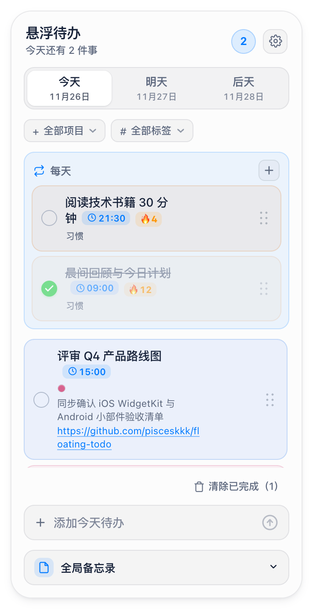
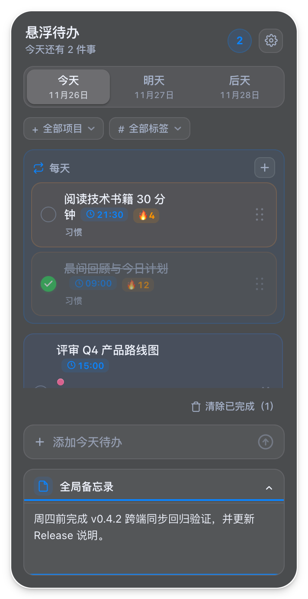
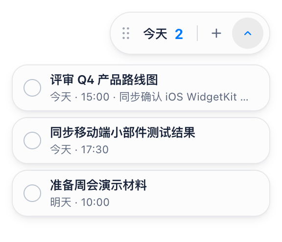
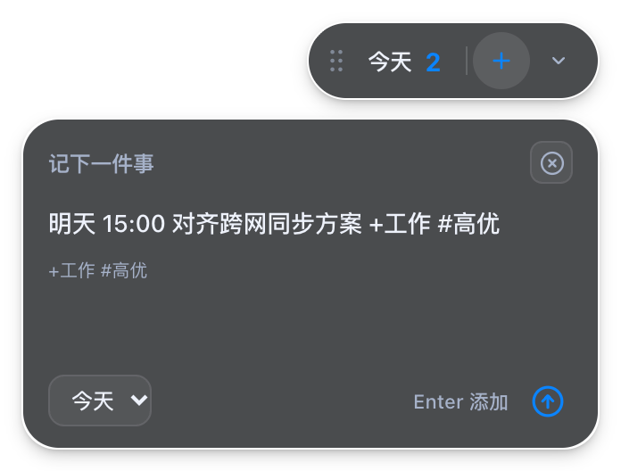
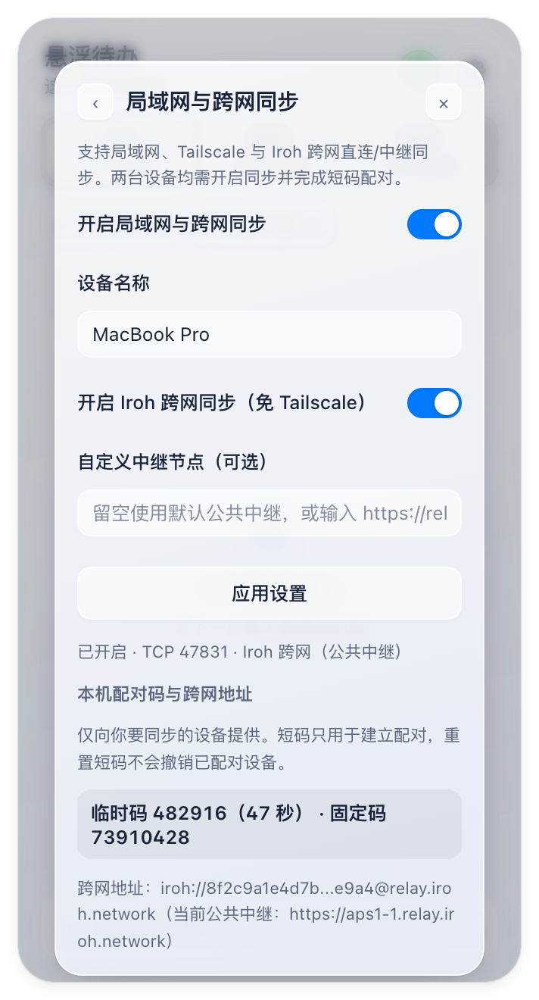

<div align="center">

# floating todo · 悬浮待办

**A lightweight, always-on, offline-first cross-platform floating todo & habit widget**

Focused on **Today / Tomorrow / Day After** · Available on **macOS / Windows / Android / iOS** · Zero ads, no account required · Decentralized sync via **Iroh P2P / LAN / Tailscale / WebDAV**

[简体中文](README.md) · [English](README.en.md) · [Downloads](https://github.com/pisceskkk/floating-todo/releases)

[](#-platforms--installation)
[](https://tauri.app)
[](https://github.com/pisceskkk/floating-todo/releases)
[](https://github.com/pisceskkk/floating-todo/stargazers)

</div>

---

## ✨ Visual Preview

<table>
  <tr>
    <td align="center" width="50%">
      <br />
      <sub><b>Light Panel</b>: 3-day view · Daily habit streaks · Project tints · Clickable links</sub>
    </td>
    <td align="center" width="50%">
      <br />
      <sub><b>Dark Panel</b>: System/manual light & dark themes · Collapsible global memo</sub>
    </td>
  </tr>
</table>

---

## 🚀 Key Highlights

### 1. Three-Day Focus + Daily Habit Streaks
- **Built for near-term execution**: Focuses strictly on **Today / Tomorrow / Day After Tomorrow**. Overdue unfinished tasks automatically roll over to Today at midnight—nothing slips through the cracks, and no endless backlog piles up.
- **Tasks and habits unified**: Pin any task as a recurring **Daily** habit with automatic streak tracking (🔥) and a lightweight confetti celebration on completion.
- **Global memo**: Optional collapsible scratchpad at the bottom of the panel for meeting links, quick notes, and ideas.

### 2. Natural-Language Quick Capture + Global Shortcut
- **Zero context switching**: Press `⌘⇧Space` (macOS) or `Ctrl+Shift+Space` (Windows) from any app to summon the widget and focus the input immediately.
- **Natural-language parsing**: Type `明天 下午3点半 提交周报 +工作 #高优` (or `明天 15:30 ...`) to automatically schedule the day, set a `15:30` local notification reminder, assign a project, and attach tags.
- **`+Project` / `#Tag` organization**: Live keyboard autocomplete on `+` or `#`, automatic 8-color palette assignment, and multi-criteria filtering.

### 3. Multi-Mode Floating Window + Native Platform Polish
- **Five seamless window modes**: Full panel, auto-compact mode on resize, floating **Mini bar**, expandable **3-recent-tasks** preview (with inline completion), and **Quick Capture** popover—smartly expanding away from screen edges.
- **Native macOS vibrancy**: Directly manages `NSVisualEffectView` for pixel-aligned corner radius and inset blur, running in macOS Accessory mode (menu bar only, no Dock clutter).
- **Windows desktop-layer pinning**: Attach the widget to the Windows desktop layer (`WorkerW`) so it stays visible even after pressing `Win+D` (Show Desktop). Supports flat/shadow styling, opacity control, and custom background colors.
- **Mouse click-through**: Let clicks pass right through the floating widget to apps underneath, and toggle interactivity back anytime from the system tray menu.

<table>
  <tr>
    <td align="center" width="46%">
      <br />
      <sub><b>Mini Bar · Recent Tasks</b>: Peek the next 3 tasks and check them off inline</sub>
    </td>
    <td align="center" width="54%">
      <br />
      <sub><b>Mini Bar · Quick Capture</b>: Instant natural-language date/time &amp; <code>+project #tag</code> capture</sub>
    </td>
  </tr>
</table>

### 4. Account-Free, Multi-Channel Decentralized Sync
Powered by local **SQLite (WAL mode)** and an **immutable Revision DAG**, every change is written locally first, works 100% offline, and merges deterministically when online:
- **LAN / Tailscale / Iroh Cross-Network P2P Sync**:
  - Automatic LAN discovery via mDNS, Tailscale node discovery via local CLI, and **built-in Iroh cross-network direct/relay sync** (no Tailscale needed; works out of the box with public relays, supports self-hosted relays and environment proxy settings).
  - Secured with **6-digit rotating pairing codes (60s) / 8-digit fixed codes + SPAKE2 key exchange + AES-256-GCM end-to-end encryption** over authenticated read-only pull & digest notifications.
- **WebDAV Sync**: Works with standard WebDAV servers (`GET / PUT / MKCOL / PROPFIND` only) with automatic background sync, focus-triggered pulls, and exponential backoff on failures.
- **Lossless conflict resolution**: Concurrent offline edits to the same item are never silently overwritten—all competing branches are preserved and can be compared, kept, replaced, edited, or saved as a new task in the visual conflict resolver.

### 5. All Four Platforms + Native Mobile Home Screen Widgets
- **One Rust + Tauri v2 core across desktop and mobile**: Supports **macOS, Windows, Android, and iOS**.
- **Tailored mobile UX**: Full-screen layout with Safe Area insets, pinch-zoom prevention, smart soft-keyboard viewport lifting (lifting only the active composer), touch long-press drag-to-reorder, and `floatingtodo://quick-capture` Deep Link launch.
- **Native Home Screen Widgets**: A shared Rust `widget_core` projection and atomic write engine powers **iOS WidgetKit (App Group shared SQLite)** and **Android AppWidget**, letting you view today's tasks and check them off directly on the home screen without launching the main WebView.

<table>
  <tr>
    <td align="center" width="50%">
      <br />
      <sub><b>LAN / Tailscale / Iroh Sync</b>: Short-code pairing · End-to-end encrypted</sub>
    </td>
    <td align="center" width="50%">
      <br />
      <sub><b>Mobile Full-Screen View</b>: Safe Area layout · Touch-first · Syncs with desktop</sub>
    </td>
  </tr>
</table>

### 6. Privacy-First + One-Click In-App Updates
- **Zero telemetry, zero cloud accounts**: WebDAV passwords and LAN pairing master keys are stored in the OS credential store (macOS Keychain / Windows Credential Manager).
- **One-click in-app updates**: Desktop builds check GitHub Releases every 6 hours without hitting GitHub API rate limits, featuring live download progress, SHA-256 verification, in-place macOS DMG replacement, and silent Windows NSIS upgrades.

---

## 🧩 Full Feature Matrix

| Category | Capabilities |
| :--- | :--- |
| **Task Management** | Today / Tomorrow / Day After views · Midnight overdue rollover · Move across days · Task descriptions with auto-linkified URLs · Clear completed |
| **Habit Tracking** | Persistent **Daily** section · Per-day completion history · Streak counter (🔥) · One-click convert between one-off task and daily habit |
| **Input & Classification** | Natural-language day & time parsing (`15:00`, `下午3点半`, etc.) · `+project` & `#tag` tokens (with quoted multi-word names) · Live autocomplete · Category manager & combined filtering |
| **Ordering & Interaction** | Pointer-event drag-and-drop (WebView-safe) · Keyboard `Alt + ↑ / ↓` reordering · Touch long-press drag on mobile · Reordering scoped within incomplete/completed groups |
| **Desktop Windowing** | Borderless 8-edge resize · Auto-compact mode · Mini bar / stack peek / 3-task preview / Quick Capture · Always-on-top · Windows desktop layer (`Win+D` persistent) · Click-through · Launch at login · System tray |
| **Appearance** | System / Light / Dark themes · Frosted glass (macOS native `NSVisualEffectView`) & flat shadow modes · Window shadow toggle · Opacity slider (20%–95%) · Custom background tint |
| **Sync & Backup** | Local SQLite (WAL) + Revision DAG · LAN mDNS / Tailscale / Iroh P2P encrypted sync · WebDAV sync · Visual conflict resolution · JSON backup export & diff-previewed merge import |
| **Reminders & Updates** | Local scheduled OS notifications (toggleable) · Automatic update check & one-click in-app install on desktop |

> For detailed technical specifications (currently written in Chinese):
> - [LAN, Tailscale & Iroh Sync Guide](docs/lan-sync.md)
> - [WebDAV Sync Protocol & Data Model](docs/webdav-sync.md)
> - [Mobile & Native Widget Architecture](docs/mobile-architecture.md)

---

## ⌨️ Shortcuts & Quick Syntax

| Shortcut / Syntax | Behavior |
| :--- | :--- |
| `⌘⇧Space` (macOS) / `Ctrl+Shift+Space` (Windows) | Summon the floating window from anywhere and focus Quick Capture |
| `明天 15:00 评审方案 +工作 #高优` | Schedule for tomorrow at `15:00`, assign project `工作` and tag `高优` |
| `+"Project Name"` / `#"High Priority"` | Quote project or tag names containing spaces |
| `Enter` / `Esc` | Submit task / Cancel edit or collapse to the floating Mini bar |
| `Alt + ↑` / `Alt + ↓` | Reorder tasks with keyboard when focused on a drag handle |
| `floatingtodo://quick-capture` | Deep Link to open the app directly into Quick Capture |

---

## 📦 Platforms & Installation

Download the latest release for your platform from [**GitHub Releases**](https://github.com/pisceskkk/floating-todo/releases):

| Platform | Package / Artifact | Notes |
| :--- | :--- | :--- |
| **macOS** | `*_aarch64.dmg` (Apple Silicon) / `*_x64.dmg` (Intel) | Native vibrancy, menu-bar Accessory mode, one-click in-app updates |
| **Windows** | `*_x64-setup.exe` | Desktop-layer pinning (`Win+D` persistent), silent in-app updates |
| **Android** | `*_android-arm64.apk` | Full-screen touch UI, WebDAV / LAN / Iroh sync |
| **iOS** | `*_ios-unsigned.ipa` | Unsigned IPA (sideload or build via Xcode), includes WidgetKit extension |

<details>
<summary><b>First-launch notes (macOS Gatekeeper / Windows SmartScreen)</b></summary>

- **macOS**: Releases use ad-hoc signing. If macOS reports the app is "damaged" or from an unidentified developer after moving it to Applications, run:
  ```sh
  xattr -dr com.apple.quarantine "/Applications/floating todo.app"
  ```
- **Windows**: If Windows Defender SmartScreen prompts on first launch, click **More info → Run anyway**.

</details>

---

## 🛠️ Architecture & Local Development

Designed to stay ultra-lightweight: **zero frontend build framework (vanilla ES Modules + CSS) + Tauri v2 + Rust native core**.

```text
floating-todo/
├── src/                      # Vanilla ES Modules frontend (shared desktop/mobile UI, sync model, classification, ordering)
├── src-tauri/                # Tauri v2 Rust backend (SQLite storage, WebDAV, updater, native window surfaces, widget_core)
│   ├── gen/android/          # Android project configuration
│   └── gen/apple/            # iOS project & TodoWidget (WidgetKit)
├── crates/lan-sync/          # Standalone Rust sync crate (axum + mDNS + Tailscale + Iroh + SPAKE2 + AES-GCM)
├── tests/                    # Unit tests (node:test), UI regression (Playwright), and native smoke tests
└── docs/                     # Sync protocol docs, mobile architecture, and UI screenshots
```

### Prerequisites
- **Node.js** 20+
- **Rust** stable toolchain
- Platform dependencies per [Tauri v2 Prerequisites](https://v2.tauri.app/start/prerequisites/)

### Common Commands

```sh
# 1. Install dependencies
npm install

# 2. Run desktop app in dev mode
npm run dev

# 3. Run test suites
npm test                                                              # JS data model & sync unit tests
PLAYWRIGHT_CHANNEL=chrome npm run test:ui                             # Playwright UI regression tests
cargo test --manifest-path crates/lan-sync/Cargo.toml --locked        # LAN / Iroh sync crate tests
cargo test --manifest-path src-tauri/Cargo.toml --lib --locked        # Tauri backend, SQLite & updater tests

# 4. Build desktop installers
npm run build
```

---

## ⭐ Support

If **floating todo** helps keep your day focused and clutter-free, consider giving it a **⭐ Star**—issues and pull requests are always welcome!
