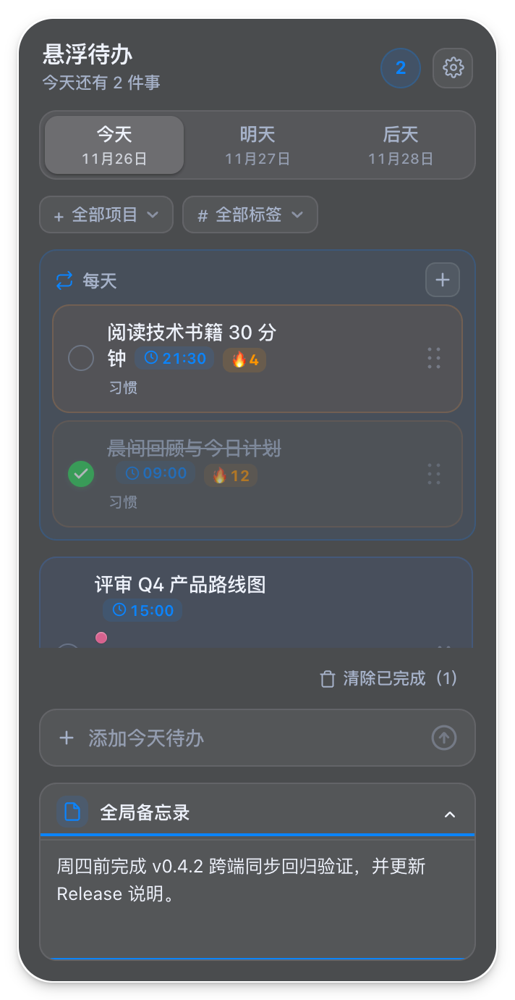
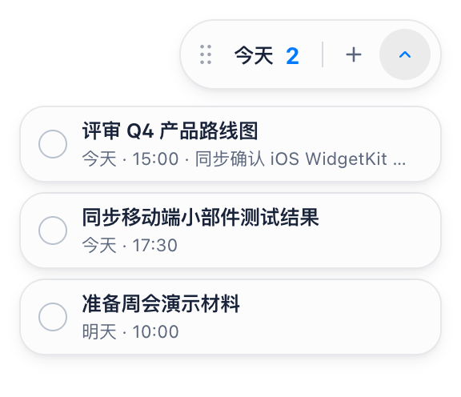
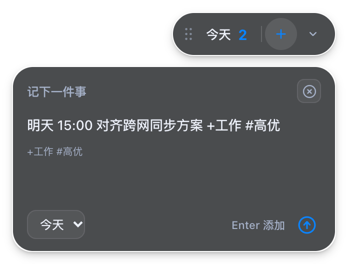
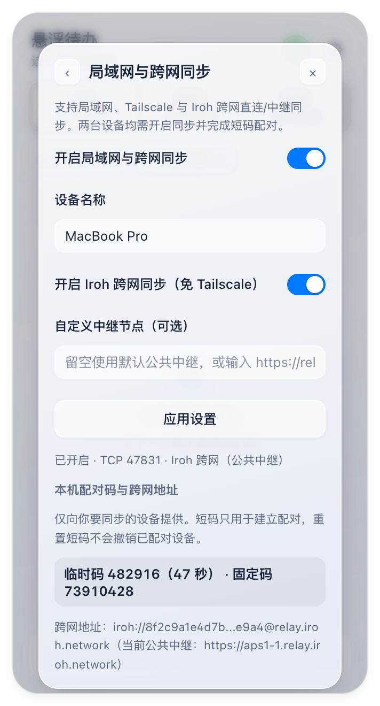

<div align="center">

# 悬浮待办 · floating todo

**轻量、常驻桌面、离线优先的跨平台悬浮待办与习惯小组件**

聚焦「今天 / 明天 / 后天」三日执行 · 支持 **macOS / Windows / Android / iOS** · 零广告、无需账号 · 支持 **Iroh 跨网 / 局域网 / Tailscale / WebDAV** 去中心化同步

[简体中文](README.md) · [English](README.en.md) · [下载安装包](https://github.com/pisceskkk/floating-todo/releases)

[](#-平台支持与下载安装)
[](https://tauri.app)
[](https://github.com/pisceskkk/floating-todo/releases)
[](https://github.com/pisceskkk/floating-todo/stargazers)

</div>

---

## ✨ 界面预览

<table>
  <tr>
    <td align="center" width="50%">
      <br />
      <sub><b>浅色主面板</b>：三日视图 · 每天打卡连胜 · 项目色卡 · 任务链接</sub>
    </td>
    <td align="center" width="50%">
      <br />
      <sub><b>深色主面板</b>：跟随系统/手动深浅切换 · 底部全局备忘录</sub>
    </td>
  </tr>
</table>

---

## 🚀 核心亮点

### 1. 三日聚焦 + 每天打卡，告别重型规划负担
- **专注近期执行**：只管理「今天 / 明天 / 后天」三天，未完成的过期事项跨午夜自动滚入「今天」，不遗漏也不堆积。
- **待办与习惯合一**：可将任意任务设为常驻「每天」打卡，自动统计连续完成天数（🔥 Streak），勾选完成附带轻量撒花动效。
- **全局备忘录**：面板底部可选开启可折叠备忘录，随手记录会议号、临时想法与链接。

### 2. 自然语言秒记 + 全局快捷键唤起
- **零切换快速捕获**：桌面端在任意应用按下 `⌘⇧Space`（Windows 为 `Ctrl+Shift+Space`），浮窗立即出现并聚焦输入框，回车即记。
- **自然语言解析**：输入 `明天 下午3点半 提交周报 +工作 #高优`，自动归入「明天」、设定 `15:30` 系统到点提醒、关联项目并打上标签。
- **`+项目` / `#标签` 体系**：输入 `+` 或 `#` 实时触发键盘自动补全与新建配色（8 色自动分配），支持按项目与标签组合筛选。

### 3. 多形态悬浮窗 + 平台原生质感
- **五种窗口形态无缝切换**：完整面板、缩放自动进入紧凑视图、收起为悬浮 Mini 栏、展开最近 3 条任务卡片（支持原地勾选）、弹出快速捕获框，贴边时自动向屏幕空余方向展开。
- **macOS 原生毛玻璃**：底层直接管理 `NSVisualEffectView` 实现精准圆角与内边距裁剪，以 Accessory 模式运行（仅驻留菜单栏，不占程序坞）。
- **Windows 桌面层固定**：支持将小组件嵌入 Windows 桌面层（`WorkerW`），按 `Win+D` 显示桌面后依然稳稳可见；支持平面阴影、窗口阴影开关与自定义透明度/背景色。
- **鼠标穿透**：一键开启后点击直接落到下层应用，不遮挡工作区，通过系统托盘菜单随时恢复交互。

<table>
  <tr>
    <td align="center" width="46%">
      <br />
      <sub><b>悬浮 Mini 栏 · 近期任务</b>：点击展开最近 3 条待办并原地打卡</sub>
    </td>
    <td align="center" width="54%">
      <br />
      <sub><b>悬浮 Mini 栏 · 快速捕获</b>：自然语言识别日期/时间与 <code>+项目 #标签</code></sub>
    </td>
  </tr>
</table>

### 4. 免账号、多通道去中心化同步
基于本地 **SQLite（WAL 模式）** 与 **不可变 Revision DAG** 数据模型，所有修改先落本地，离线完全可用，联网后按版本图自动合并：
- **局域网 / Tailscale / Iroh 跨网 P2P 同步**：
  - 局域网通过 mDNS 自动发现，Tailscale 自动识别虚拟网节点，**内置 Iroh 跨网直连/中继（免 Tailscale、支持默认公共中继或自建中继，支持环境变量代理）**。
  - 采用 **6 位动态临时码（60 秒轮换）/ 8 位固定码 + SPAKE2 密钥协商 + AES-256-GCM 端到端加密**，仅开放受认证的只读版本拉取与摘要通知，拒绝未授权写入。
- **WebDAV 云同步**：兼容标准 WebDAV（仅需 `GET / PUT / MKCOL / PROPFIND`），支持自动定时同步、窗口聚焦拉取与失败退避重试。
- **无损冲突解决**：多端离线同时修改同一事项时不会静默覆盖，自动保留所有并发分支，可在冲突面板中对比、保留、替换、编辑或另存为新任务。

### 5. 全平台覆盖 + 移动端原生桌面小部件
- **统一核心跨四端**：基于 Tauri v2 + Rust 共享核心，覆盖 **macOS、Windows、Android 与 iOS**。
- **移动端专属体验**：自动切换全屏布局与刘海/安全区适配、禁用误触缩放、软键盘弹出时仅顶起主输入框保持界面稳定、支持触摸长按拖拽排序与 `floatingtodo://quick-capture` Deep Link 快捷拉起。
- **原生桌面小部件**：Rust 侧下沉轻量 `widget_core` 投影与原子写入引擎，支撑 **iOS WidgetKit（App Group 共享 SQLite）** 与 **Android AppWidget** 在不启动主应用的前提下直接展示今日任务并原地勾选打卡。

<table>
  <tr>
    <td align="center" width="50%">
      <br />
      <sub><b>局域网 / Tailscale / Iroh 跨网同步</b>：短码配对 · 端到端加密</sub>
    </td>
    <td align="center" width="50%">
      <br />
      <sub><b>移动端全屏视图</b>：安全区适配 · 触控优化 · 与桌面端数据互通</sub>
    </td>
  </tr>
</table>

### 6. 隐私优先 + 应用内一键更新
- **零数据收集**：无云端应用账号、无埋点统计；WebDAV 密码与局域网配对主密钥保存在系统原生凭据库（macOS Keychain / Windows 凭据管理器）。
- **应用内一键更新**：桌面端每 6 小时自动检测 GitHub Releases（不消耗 GitHub API 匿名配额），支持实时下载进度显示、SHA-256 完整性校验、macOS DMG 原地替换重启与 Windows NSIS 静默升级重启。

---

## 🧩 完整能力矩阵

| 模块 | 核心能力 |
| :--- | :--- |
| **任务管理** | 今天 / 明天 / 后天三日切换 · 过期待办自动滚入今天 · 跨天移转 · 任务描述与 URL 自动识别点击 · 清除已完成 |
| **习惯打卡** | 常驻「每天」分组 · 逐日打卡记录 · 连续天数（🔥 Streak）计算 · 普通待办与每天习惯一键互转 |
| **输入与分类** | 自然语言日期（今天/明天/后天）与时间（`15:00` / `下午3点半` / `晚上8点`）解析 · `+项目` 与 `#标签`（支持带空格引号） · 实时自动补全 · 分类管理与组合筛选 |
| **排序与交互** | 指针拖拽排序（兼容 WebView） · 键盘 `Alt + ↑ / ↓` 排序 · 移动端长按拖拽 · 仅在未完成/已完成分组内重排 |
| **桌面窗口** | 无边框八方向自由缩放 · 紧凑模式 · Mini 悬浮栏 / 堆叠预览 / 近期 3 任务 / 快速捕获 · 始终置顶 · Windows 固定桌面层（`Win+D` 仍可见） · 鼠标穿透 · 开机自启 · 系统托盘 |
| **外观定制** | 跟随系统 / 浅色 / 深色主题 · 毛玻璃（macOS 原生 `NSVisualEffectView`）与平面阴影切换 · 窗口阴影开关 · 透明度滑块（20%–95%） · 自定义背景色 |
| **同步与备份** | 本地 SQLite（WAL）+ Revision DAG · 局域网 mDNS / Tailscale / Iroh 跨网 P2P 加密同步 · WebDAV 同步 · 可视化冲突解决 · JSON 备份导出与带差异预览的合并导入 |
| **提醒与更新** | 本机到点系统通知（可独立开关） · 桌面端自动检查更新与一键下载替换安装 |

> 深入技术细节与同步协议规范，请参阅：
> - [局域网与 Tailscale / Iroh 同步说明](docs/lan-sync.md)
> - [WebDAV 同步协议与数据模型](docs/webdav-sync.md)
> - [移动端与原生小部件架构文档](docs/mobile-architecture.md)

---

## ⌨️ 快捷键与输入速查

| 操作 / 语法 | 说明 |
| :--- | :--- |
| `⌘⇧Space`（macOS） / `Ctrl+Shift+Space`（Windows） | 全局唤起浮窗并聚焦输入框（快速捕获） |
| `明天 15:00 评审方案 +工作 #高优` | 自动识别日期为明天、提醒 `15:00`、项目「工作」、标签「高优」 |
| `下午3点半` / `晚上8点30` / `9点` | 支持中文口语化时间与 24 小时制时间解析 |
| `+"带空格的项目"` / `#"核心 目标"` | 使用引号输入包含空格的项目名或标签名 |
| `Enter` / `Esc` | 提交待办 / 取消编辑或收起为悬浮 Mini 栏 |
| `Alt + ↑` / `Alt + ↓` | 聚焦任务拖拽手柄时使用键盘上下调整排序 |
| `floatingtodo://quick-capture` | Deep Link 唤起应用并直接进入快速捕获 |

---

## 📦 平台支持与下载安装

前往 [**GitHub Releases**](https://github.com/pisceskkk/floating-todo/releases) 下载对应平台的最新安装包：

| 平台 | 架构 / 产物 | 说明 |
| :--- | :--- | :--- |
| **macOS** | `*_aarch64.dmg` (Apple Silicon) / `*_x64.dmg` (Intel) | 支持应用内一键更新、原生毛玻璃与状态栏驻留 |
| **Windows** | `*_x64-setup.exe` | 支持应用内静默更新、固定桌面层（`Win+D` 仍可见） |
| **Android** | `*_android-arm64.apk` | 支持全屏触控布局、WebDAV / 局域网 / Iroh 同步 |
| **iOS** | `*_ios-unsigned.ipa` | 未签名 IPA（需自签或 Xcode 编译安装），内置 WidgetKit 小部件 |

<details>
<summary><b>首次安装常见问题（macOS 未公证提示 / Windows SmartScreen）</b></summary>

- **macOS**：当前使用 ad-hoc 签名，首次拖入「应用程序」后若提示「已损坏」或「无法验证开发者」，在终端执行以下命令即可正常打开：
  ```sh
  xattr -dr com.apple.quarantine "/Applications/floating todo.app"
  ```
- **Windows**：首次运行安装程序若触发 Windows Defender SmartScreen 提示，点击「**更多信息** → **仍要运行**」即可。

</details>

---

## 🛠️ 技术架构与本地开发

项目坚持极致轻量设计：**零前端构建框架（原生 ES Modules + CSS） + Tauri v2 + Rust 原生核心**。

```text
floating-todo/
├── src/                      # 原生 ES Modules 前端（桌面/移动端共用 UI、同步模型、分类与排序）
├── src-tauri/                # Tauri v2 Rust 后端（SQLite 存储、WebDAV、更新器、平台原生窗口、widget_core）
│   ├── gen/android/          # Android 工程配置
│   └── gen/apple/            # iOS 工程与 TodoWidget (WidgetKit)
├── crates/lan-sync/          # 独立 Rust 同步核心库（axum + mDNS + Tailscale + Iroh + SPAKE2 + AES-GCM）
├── tests/                    # 单元测试（node:test）、UI 回归（Playwright）与原生冒烟测试
└── docs/                     # 同步协议、移动端架构文档与界面预览资源
```

### 环境要求
- **Node.js** 20+
- **Rust** stable 工具链
- 按 [Tauri v2 官方先决条件](https://v2.tauri.app/start/prerequisites/) 安装对应平台依赖

### 常用命令

```sh
# 1. 安装依赖
npm install

# 2. 启动桌面端开发模式
npm run dev

# 3. 运行测试套件
npm test                                                              # JS 数据模型与同步单元测试
PLAYWRIGHT_CHANNEL=chrome npm run test:ui                             # Playwright 前端 UI 回归测试
cargo test --manifest-path crates/lan-sync/Cargo.toml --locked        # 局域网 / Iroh 同步核心库测试
cargo test --manifest-path src-tauri/Cargo.toml --lib --locked        # Tauri 后端与 SQLite/更新器测试

# 4. 构建桌面端安装包
npm run build
```

---

## ⭐ 支持项目

如果 **悬浮待办** 帮你记住了重要的小事、让桌面更专注，欢迎点一个 **⭐ Star**，也欢迎提交 Issue 或 PR 一起完善它！
